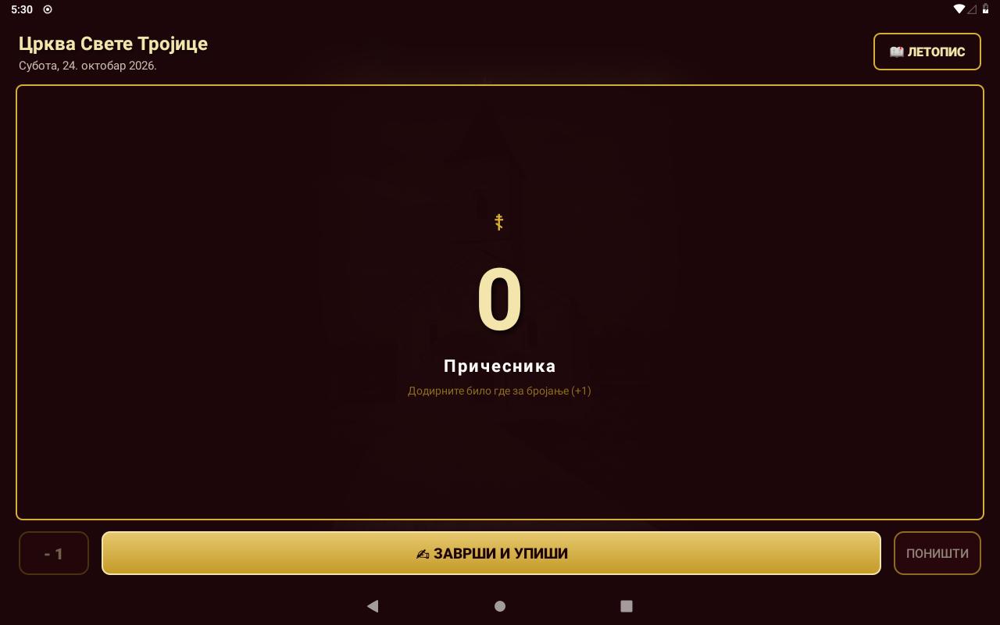
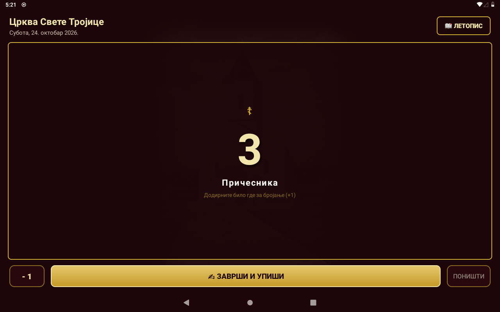
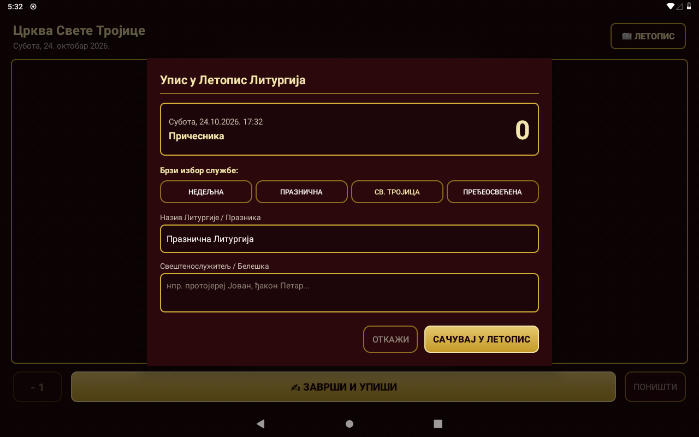
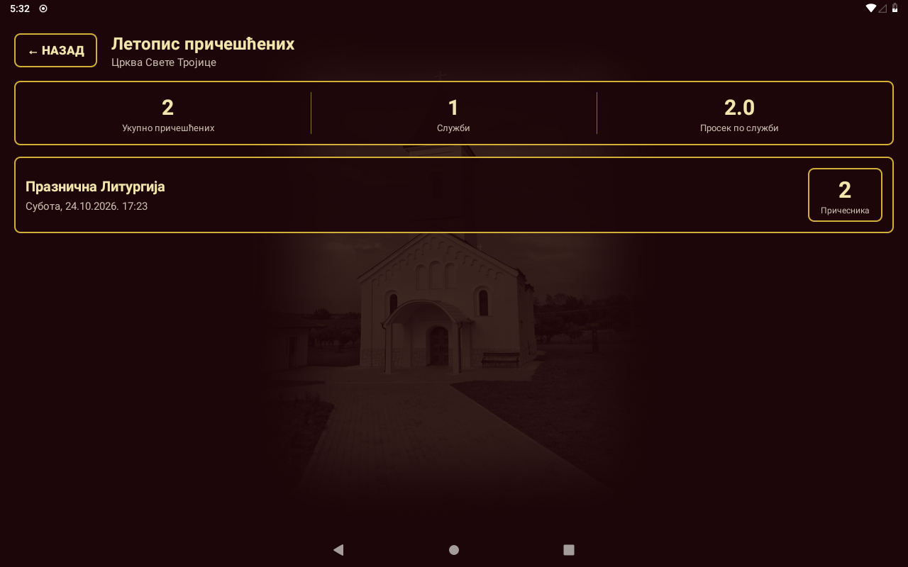

# ☦ Бројач причесника — Црква Свете Тројице

> **Нативна Android апликација за дискретно бројање причесника на Светој Литургији и дигитални црквени Летопис.**  
> *Orthodox Communion Counter & Liturgical Chronicle for Android.*

-gold)


---

## 📖 О пројекту

У православним храмовима постоји вековна традиција вођења књиге евиденције причешћених верника на свакој Светој Литургији. Ова апликација је развијена како би се то пребројавање модернизовало и олакшало током самог богослужења, уз потпуно поштовање богослужбеног поретка, тишине и достојанства светог храма.

Апликација је специјално оптимизована за **Samsung Galaxy Note 10.1** (LineageOS 16.0 / Android 9 Pie) за коришћење у олтару, певници или на аналоју.

---

## ✨ Главне функционалности

* **Дискретно бројање (+1 на додир):**
  * Централни део екрана заузима преко 70% површине — довољан је благ додир било где без потребе за прецизним нишањењем или сталним гледањем у екран.
  * **100% нечујно:** Сви звучни сигнали су уклоњени (никакав тон или бип не сме да се огласи током службе).
  * **Хаптичка повратна спрега:** Сваки додир прати тиха, кратка вибрација таблета под прстом као физичка потврда уноса.
* **Будан екран (Keep Screen On):**
  * Екран остаје активан све време док траје причешћивање — таблет се не закључава и не одлази у стање спавања.
* **Исправка грешке `[- 1]`:**
  * Уколико се деси случајан дупли додир, дискретно дугме у углу омогућава тренутно одузимање.
* **Заштита података од случајног губитка:**
  * Тренутно стање бројача се аутоматски бележи у трајну меморију (`SharedPreferences`). Чак и ако се апликација затвори или батерија испразни, бројање се наставља тачно тамо где је стало.
  * Дугме **«Поништи»** садржи сигурносни дијалог са питањем за потврду.
* **Црквени Летопис (База података):**
  * Кликом на златно дугме **`✍ ЗАВРШИ И УПИШИ`** отвара се брзи прозор за архивирање.
  * Брзи избор службе: *«Недељна Литургија»*, *«Празнична Литургија»*, *«Храмовна слава - Света Тројица»*, *«Пређеосвећена Литургија»* или слободан ручни унос.
  * Опционо поље за напомену (свештенослужитељ, појци, белешка).
  * Трајно складиштење у локалној SQLite бази података на самом уређају (100% офлајн, без интернета).
* **Преглед књиге и литургијска статистика:**
  * Хронолошки преглед свих одслужених служби.
  * Збирна статистика на врху: **укупан број причешћених**, **број одслужених Литургија** и **просечан број причесника по служби**.
  * Опција брисања појединачног записа дужим притиском уз потврду.

---

## 🎨 Визуелни идентитет

* **Литургијска византијска палета:**
  * Позадина: Дубока тамна византијска бордо боја (`#1C0609` и `#2A080C`), пријатна за очи и незаслепљујућа у полумраку храма.
  * Елементи и бројеви: Литургијско злато (`#D4AF37`, `#F3E5AB`).
  * Текст: Топла боја пергамента (`#FDFBF7`).
* **Мотив храма:**
  * У позадини бројача дискретно је интегрисан водени жиг фасаде и звоника **цркве Свете Тројице**.
* **Икона апликације:**
  * Златни православни крст са контуром храма у византијском кружном оквиру.

---

## 📸 Слике апликације (Screenshots)

| Главни екран за бројање | Бројање у току (+1) |
| :---: | :---: |
|  |  |

| Прозор за упис у Летопис | Црквени Летопис и статистика |
| :---: | :---: |
|  |  |

---

## 📦 Преузимање и инсталација

Готов инсталациони APK фајл доступан је директно у фолдеру:
👉 **[`release/CommunionCounter.apk`](release/CommunionCounter.apk)** *(~265 KB)*

Инсталација преко USB кабла (ADB):
```bash
adb install -r release/CommunionCounter.apk
```

---

## 🛠️ Израда из изворног кода (Build)

Апликација је намењена брзом и чистом компајлирању без Gradle зависности помоћу директних Android SDK алатки:

```bash
# 1. Покрените скрипту за компајлирање и паковање
./scripts/build_and_deploy.sh
```

Скрипта аутоматски:
1. Користи `aapt2` за компајлирање ресурса и генерисање `R.java`.
2. Компајлира Java изворни код (`javac --release 8`).
3. Претвара bytecode у Dalvik `classes.dex` преко `d8`.
4. Врши поравнање преко `zipalign` и потписује APK преко `apksigner`.
5. Уколико је таблет повезан преко USB-а, аутоматски инсталира апликацију и покреће је на екрану.

---

## 📜 Лиценца

Овај пројекат је намењен слободној употреби у богослужбене сврхе Српске Православне Цркве и свих православних парохија.
